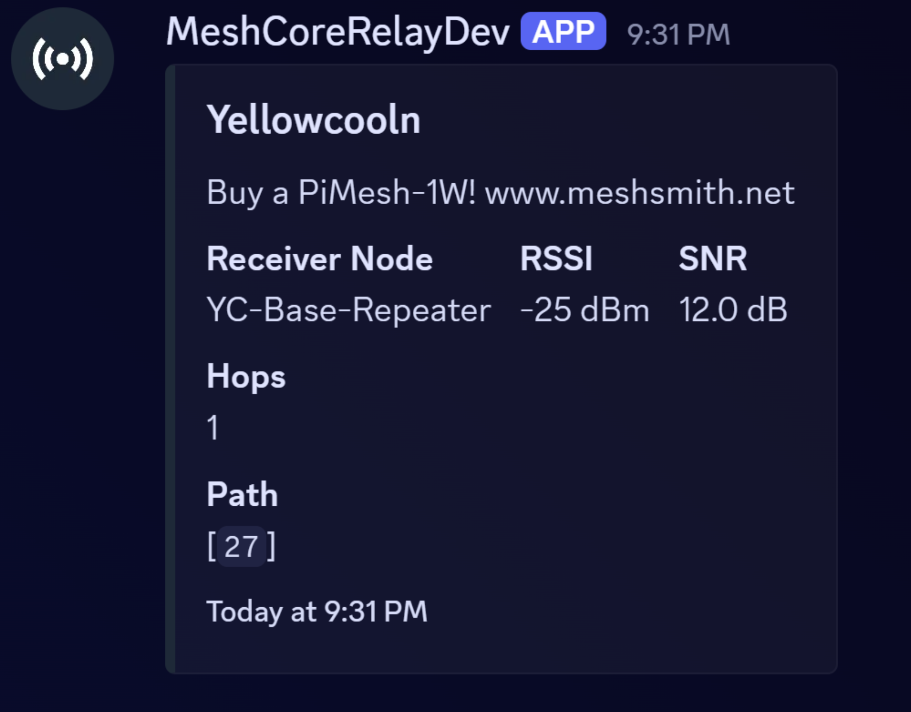
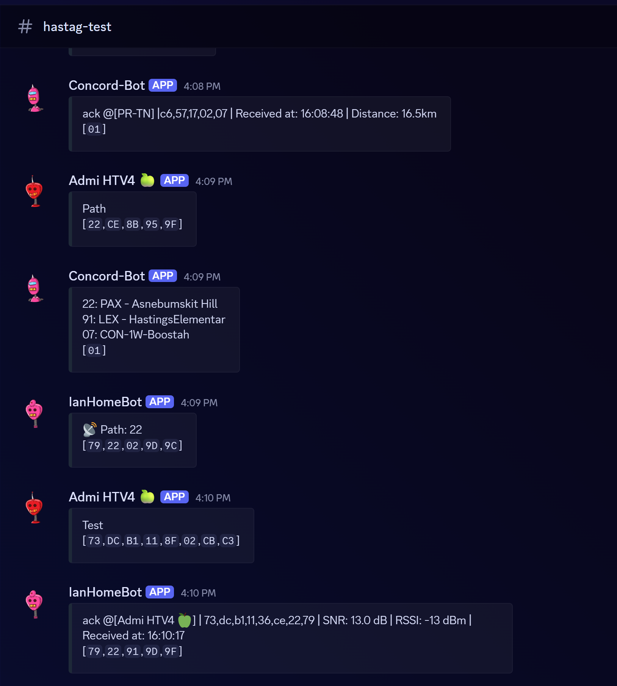
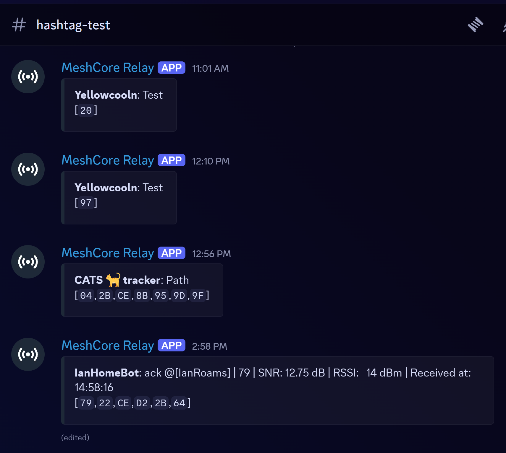

<h1 align="center">MeshCore Discord Relay</h1>

<p align="center">
  Bring MeshCore channel messages into Discord.<br />
  Self-hosted MQTT relay with bot and webhook delivery.
</p>

<p align="center">
  <a href="https://github.com/yellowcooln/meshcore-discord-relay/releases"></a>
  <a href="https://github.com/yellowcooln/meshcore-discord-relay/actions/workflows/tests.yml?query=branch%3Amain"></a>
  <a href="https://github.com/yellowcooln/meshcore-discord-relay/actions/workflows/docker-publish.yml?query=branch%3Amain"></a>
  <a href="https://hub.docker.com/r/yellowcooln/meshcore-discord-relay"></a>
</p>

<p align="center">
  <a href="#quick-start">Quick start</a> &middot;
  <a href="./howto.md">Documentation</a> &middot;
  <a href="#configuration">Configuration</a> &middot;
  <a href="./CHANGELOG.md">Changelog</a> &middot;
  <a href="https://github.com/yellowcooln/meshcore-discord-relay/issues">Report an issue</a>
</p>



<p align="center"><em>Detailed bot output. Simple bot embeds and per-sender webhook messages are also available.</em></p>

## Features

- Relay MeshCore GroupText messages from MQTT into Discord using `@michaelhart/meshcore-decoder` and your channel secrets.
- Choose a Discord bot or webhooks with per-sender names and avatars.
- Route each MeshCore channel to its own Discord destinations, or send everything to one master destination.
- Filter by observer or MQTT topic and deduplicate repeated messages.
- Show optional paths and public scope labels; bot messages can update as additional hops arrive.
- Run the published Docker image or build from source, with YAML or JSON configuration.

**This is a one-way relay: MeshCore → MQTT → Discord.** It does not send Discord messages back over the mesh. Only messages with a matching channel decryption secret can be relayed.

## Quick start

### Run the prebuilt Docker image

The published image is [`yellowcooln/meshcore-discord-relay:latest`](https://hub.docker.com/r/yellowcooln/meshcore-discord-relay). No local build is required.

You need Docker with the Compose plugin, MQTT subscriber access, your MeshCore channel secret, and either a Discord bot token or a Discord webhook URL.

Download the configuration examples into a new directory:

```bash
mkdir meshcore-discord-relay
cd meshcore-discord-relay
curl -fsSL https://raw.githubusercontent.com/yellowcooln/meshcore-discord-relay/main/.env.example -o .env
curl -fsSL https://raw.githubusercontent.com/yellowcooln/meshcore-discord-relay/main/channels.yaml.example -o channels.yaml
curl -fsSL https://raw.githubusercontent.com/yellowcooln/meshcore-discord-relay/main/webhooks.yaml.example -o webhooks.yaml
curl -fsSL https://raw.githubusercontent.com/yellowcooln/meshcore-discord-relay/main/docker-compose.image.yaml.example -o docker-compose.yaml
```

Before starting:

1. Edit `.env` with your MQTT host, port, transport, credentials, and topic.
2. Choose `DISCORD_DELIVERY_MODE=bot` or `webhook` using the table below.
3. Configure the channel secret and Discord destinations in the appropriate YAML file. Keep both files present because the supplied Compose example mounts both.

| Delivery | Configure | Output |
| --- | --- | --- |
| `bot` | Set `DISCORD_TOKEN` in `.env`; put channel secrets and Discord channel IDs in `channels.yaml`. | One bot identity, with simple or detailed embeds and optional later path edits. |
| `webhook` | Set channel secrets and webhook URLs in `webhooks.yaml`; no bot token needed. | Per-sender display names and robot avatars, without later path edits. |

For bot setup, file examples, and routing choices, follow the [deployment guide](./howto.md#5-choose-delivery-mode). Switching an existing bot installation? See [MIGRATION.md](./MIGRATION.md).

**Docker networking:** `MQTT_HOST=localhost` points at the relay container, not your host. The supplied Compose file maps `host.docker.internal` to the Linux host gateway. Use that for a reachable host broker, or use the broker's service name on a shared Docker network. Leave `MQTT_TLS_INSECURE=false` for normal use.

Pull the image, start the relay, and inspect its logs:

```bash
docker compose pull
docker compose up -d
docker compose logs --tail=100 -f meshcore-discord-relay
```

There is no web UI or published HTTP port. Check for the Discord delivery and MQTT connection messages in the logs. When you are ready to test, send a message on the configured MeshCore channel and check its Discord destination. The [verification guide](./howto.md#7-verify-it-works) explains what to look for.

### Build from source instead

```bash
git clone https://github.com/yellowcooln/meshcore-discord-relay.git
cd meshcore-discord-relay
cp .env.example .env
cp channels.yaml.example channels.yaml
cp webhooks.yaml.example webhooks.yaml
```

Configure the files as above, keep the repository's build-based `docker-compose.yaml`, then run:

```bash
docker compose up -d --build
```

## Configuration

See [`.env.example`](./.env.example) for all settings and the [deployment guide](./howto.md) for detailed examples, optional features, and troubleshooting.

| Setting | Purpose |
| --- | --- |
| `MQTT_HOST`, `MQTT_PORT`, `MQTT_TRANSPORT` | Broker address and TCP/WebSocket transport. |
| `MQTT_USERNAME`, `MQTT_PASSWORD` | Subscriber credentials, when required. |
| `MQTT_TOPIC` | Broker topic subscription. |
| `MQTT_TLS`, `MQTT_CA_CERT`, `MQTT_WS_PATH` | TLS and WebSocket connection settings. |
| `DISCORD_DELIVERY_MODE`, `DISCORD_TOKEN` | Bot/webhook selection and bot authentication. |
| `DISCORD_ROUTE_MODE` | `per_channel` mappings or a single `master` destination. |
| `DISCORD_MASTER_CHANNEL_ID`, `DISCORD_DEFAULT_CHANNEL_ID` | Master/fallback destinations for bot delivery. |
| `CHANNELS_FILE`, `WEBHOOKS_FILE` | Channel decryption and destination mappings. |
| `MQTT_OBSERVER_ALLOWLIST`, `MQTT_TOPIC_WHITELIST` | Optional observer and topic filters. |
| `RELAY_DEDUPE_SECONDS` | Message deduplication window; default 45 seconds. |
| `RELAY_BOT_MESSAGE_MODE` | `simple` or `detailed` bot embeds. |
| `RELAY_SHOW_PATH`, `RELAY_PATH_WAIT_MS` | Optional path display and collection delay. |
| `RELAY_SHOW_SCOPE`, `RELAY_SCOPE_NAMES` | Optional scope display and public-name candidates. |

Scope display is off by default and does not change routing or filtering. Put settings in `.env`, not the channel files, and quote names containing `#`:

```env
RELAY_SHOW_SCOPE=true
RELAY_SCOPE_NAMES="#Local,#Regional"
```

Unknown scopes display a packet-specific code; multiple name matches are marked ambiguous. See [Optional message scopes](./howto.md#optional-message-scopes) for limitations.

Keep bot tokens, webhook URLs, MQTT passwords, and private channel secrets out of Git and shared logs. The relay posts decrypted messages into Discord, so only configure channels you intend to share there.

## Message examples

### Webhook delivery

Each sender uses its own display name and robot avatar.



### Simple bot delivery

A compact sender/message embed posted by one bot identity.



Detailed bot delivery is shown at the top of this README. It adds receiver, RSSI, SNR, hops, and path fields; the channel field appears in master routing mode.

## Updates

For an installation using the prebuilt image:

```bash
docker compose pull meshcore-discord-relay
docker compose up -d --no-build meshcore-discord-relay
```

After editing `.env`, recreate the service with the intended image already pulled:

```bash
docker compose up -d --no-build --pull never --force-recreate meshcore-discord-relay
```

A plain `docker compose restart` does not reload Compose environment-file values. Preserve `.env` and your channel/webhook files when updating. See the [update guide](./howto.md#8-updates-and-configuration-changes) for source builds.

## Development

Use Node.js 24 or newer. Install the locked dependencies and run the tests:

```bash
npm ci
npm test
```

Use `npm run test:watch` for watch mode. Build local source changes with `docker compose up -d --build`.

## License

Copyright (c) 2026 yellowcooln and contributors.

Licensed under the [GNU General Public License version 3 only](./LICENSE) (`GPL-3.0-only`). You may use, modify, and redistribute this software under its terms. Distributed modified versions must be licensed under GPL version 3 and include the corresponding source as required by the license. This software comes without warranty.

Third-party dependencies and assets retain their own licenses and notices.

## About these projects

I build these projects with the help of AI when I see a need for software I want to use myself. The goal is to make something useful, run it on my own systems, and share it with anyone else who might find it helpful.

This is something I do for fun, in my free time outside of work and family. If you find these tools useful and would like to support the time that goes into them, a little support on [Ko-fi](https://ko-fi.com/yellowcooln) is always appreciated. No pressure. Using the software, reporting bugs, and contributing ideas helps too.
